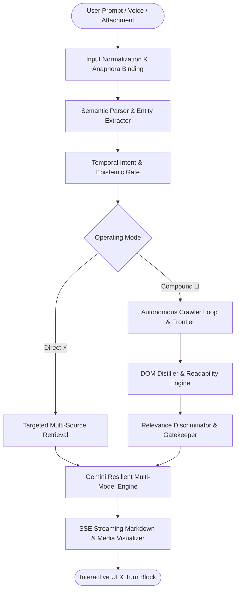

# 🕷️ Spider AI

> **Autonomous Perceptive AI Search & Cognitive Investigation Engine**  
> *Transforming conversational search into an active, verified, multi-modal web exploration agent.*

---

## 📖 Overview

**Spider AI** is a next-generation autonomous AI search and investigative web agent. Unlike conventional conversational interfaces that suffer from hallucinations, stale knowledge cutoffs, and context drift, Spider AI combines real-time multi-engine search, autonomous web crawling, temporal intent gating, and rigorous multi-model verification to deliver grounded, citation-backed intelligence.

Built on **Django 6**, **Google Gemini 2.5/2.0**, and **Playwright**, Spider AI is architected from the ground up to solve complex queries that require live synthesis across articles, documents, videos, and multi-turn dialogue.

---

## ✨ Key Features & Capabilities

### ⚡ Dual-Mode Cognitive Operating Framework
* **Direct Mode (⚡)**: Low-latency, deterministic factual answering. Performs swift intent classification, targeted single-pass search, and crisp markdown synthesis.
* **Compound Mode (🧬)**: Deep autonomous multi-pass web research. Activates autonomous crawler frontiers, DOM distillation, and multi-source cross-verification before producing exhaustive structured briefs.

### 🧠 Temporal Intent & Epistemic Gating
* **Grammatical Tense & Horizon Recognition**: Analyzes verb forms, past/present/future markers, and temporal anchors.
* **Epistemic Rate-of-Change Classification**: Distinguishes between immutable knowledge (mathematical formulae, scientific constants), stable facts (historical events), periodic updates (monthly/quarterly statistics), and hyper-dynamic state (ticket availability, live sports scores, real-time stock prices).
* **Smart Recency Weighting**: Automatically suppresses stale cached content when real-time state is requested.

### 🔄 Multi-Turn Elliptical Intent Binding (Zero Context Drift)
* **Elliptical Modifier Resolution**: Seamlessly merges follow-up qualifiers (e.g., *"in ubuntu via cli"*, *"on macos"*, *"without rufus"*) into the active conversational goal.
* **Coreference & Aspect Binding**: Preserves task history across turns without falling back to generic tutorials.
* **Input Keyboard History (`↑` / `↓`)**: Terminal-style readline prompt traversal allows users to cycle through previous queries with draft preservation and MRU caching.

### 🎙️ Universal Dual-Engine Voice System
* **Client-Side Web Speech Recognition**: Instant, live streaming dictation for supported browsers (Chrome, Edge, Safari).
* **Server-Side Audio Transcription Engine**: Automatic fallback for Firefox, Linux, and non-supported environments using audio streaming and Gemini multimodal transcription.

### 📎 Multi-Format Document & Media Ingestion
* **Attachment Tray**: Drag-and-drop or select PDFs, Images (PNG, JPG, WEBP), CSVs, and Plain Text files.
* **Document Grounding**: Direct visual and semantic document analysis combined with external web intelligence.

### 🎬 Interactive Media & Visual Citations
* **Picture-in-Picture & Theater Video Player**: Embedded YouTube video modal with minimization, blur backdrop, and PiP reading mode so you can continue reading answers while watching.
* **Visual Verification Badges**: Value-density scores, source freshness indicators, and clickable citations `[1]`, `[2]`.

---

## 🏛️ Architecture & System Topology



---

## 🚀 Quick Start Guide

### Option 1: Local Development Setup

#### Prerequisites
* Python 3.12+
* Google Gemini API Key ([Get one here](https://aistudio.google.com/app/apikey))
* Git

#### 1. Clone the Repository
```bash
git clone https://github.com/JoshkefGhost6958/spider-ai.git
cd spider-ai
```

#### 2. Create and Activate Virtual Environment
```bash
python3 -m venv .venv
source .venv/bin/activate
```

#### 3. Install Dependencies & Playwright Browsers
```bash
pip install -r requirements.txt
playwright install chromium
```

#### 4. Configure Environment Variables
```bash
cp .env.example .env
```
Edit `.env` and configure your `GEMINI_API_KEY`:
```ini
GEMINI_API_KEY=AIzaSy...your-gemini-api-key
DJANGO_DEBUG=True
ALLOWED_HOSTS=localhost,127.0.0.1
```

#### 5. Apply Database Migrations & Run Development Server
```bash
python manage.py migrate
python manage.py runserver 0.0.0.0:8000
```
Open [http://localhost:8000](http://localhost:8000) in your web browser.

---

### Option 2: Docker & Docker Compose (Recommended for Production)

#### 1. Build and Run with Docker Compose
```bash
# Copy and configure environment variables
cp .env.example .env

# Build and start container in detached mode
docker compose up -d --build
```

#### 2. Verify Container Health
```bash
docker compose ps
docker compose logs -f
```
The application will be live at [http://localhost:8000](http://localhost:8000).

---

## 🧪 Automated Testing & Verification

Spider AI includes a comprehensive test suite covering retrieval guardrails, temporal intent classification, upload pipelines, and UI regressions:

```bash
# Run test suite
python manage.py test core
```
*All 25 automated unit and regression scenarios are verified and passing.*

---

## 🔒 Security Best Practices

* **No Hardcoded Secrets**: All credentials and API keys are strictly loaded via environment variables.
* **Public Repository Guardrails**: `.gitignore` and `.dockerignore` prevent accidental commits of `.env` files, sqlite databases, uploaded media, and virtual environments.
* **Non-Root Docker Execution**: Container runs under a dedicated, unprivileged `appuser` (UID 1000).
* **Cross-Origin & Referrer Policies**: Configured for secure video embedding and cross-origin resource isolation.

---

## 📄 License & Attribution

Distributed under the Apache 2.0 License. Built for advanced agentic AI search and cognitive intelligence.
