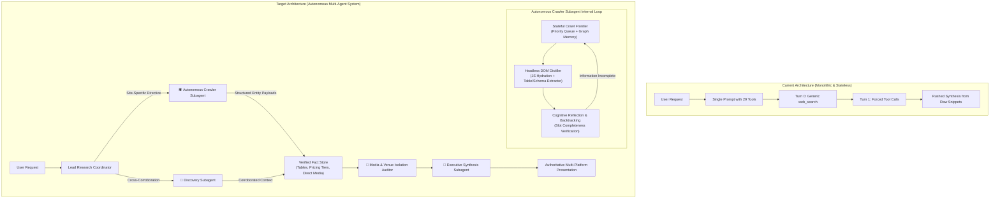
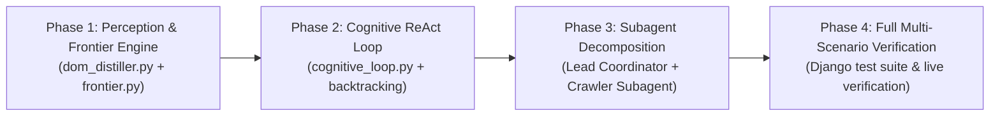

# Architectural Transformation Plan: Autonomous Cognitive Crawler & Multi-Agent System

## 1. Executive Summary

This blueprint outlines the architectural evolution of **Spider AI** from a monolithic, stateless 2-turn tool executor into a true **Autonomous Cognitive Multi-Agent Crawler System**. 

The fundamental limitation of the current design is that **tools are passive**: giving an LLM a list of 29 function declarations without execution state, perception pipelines, or self-reflection causes cognitive overload, defaults to shallow web search, and surrenders after 2 arbitrary turns. 

This plan introduces:
1. **A Stateful Crawl Frontier & Navigation Graph Engine**
2. **A Semantic DOM Distiller & Dynamic Perception Layer**
3. **A Goal-Driven ReAct Loop with Backtracking & Slot-Filling Termination**
4. **An Epistemic Source Authority Engine (Tiers 1–3)**
5. **Decoupled Specialized Subagents** (Lead Coordinator, Autonomous Crawler, Discovery, Media Auditor, Synthesizer)

---

## 2. System Architecture: Monolithic vs. Autonomous Multi-Agent



---

## 3. Core Architectural Modules to Build

### Module A: Stateful Crawl Frontier Engine (`core/modules/crawler/frontier.py`)
A stateful graph memory managing the traversal queue:
* **Priority Queue (`URLQueue`):** Ranks candidate links based on lexical similarity to the user's information requirements (e.g., links containing `/tickets`, `/seating-map`, `/pricing`, `/hospitality`, `/book` receive top priority $+50$).
* **Path Pruning & Domain Jail:** Strictly locks traversal to the target domain and canonical subdomains, while pruning administrative noise (`/privacy`, `/terms`, `/login`, `wp-admin`).
* **Visited Graph & Loop Prevention:** Tracks canonicalized SHA-256 URL hashes to guarantee zero circular traversal or infinite redirect loops.
* **Autonomous Budgeting:** Supports configurable exploration limits (e.g., maximum depth $= 3$, maximum hops $= 6$, execution time ceiling $= 15\text{s}$).

### Module B: Semantic DOM Distiller & Perception Layer (`core/modules/crawler/dom_distiller.py`)
Replaces unparsed raw HTML dumps with clean semantic perception:
* **Interactive Element Extraction:** Identifies CTA buttons, booking links, and dropdown selectors (`[Button: Book Regular - KSh 2,500]`).
* **Structured Table Normalizer:** Automatically parses HTML `<table>` elements and CSS grid structures into normalized JSON dictionaries:
  ```json
  [
    {"tier": "General Admission", "level": "Level 1, 2, 3", "price": "KSh 2,500", "availability": "Active"},
    {"tier": "Business VIP", "level": "Level 2 Main Stand", "price": "KSh 22,000", "availability": "Limited"}
  ]
  ```
* **Schema.org / JSON-LD Harvester:** Automatically extracts schema markup (`Event`, `Place`, `Offer`, `SportsEvent`) embedded in the DOM.
* **High-Res Media Harvester:** Isolates high-fidelity visual diagrams (SVG seating plans, stadium bowl renders, official promotional banners) while discarding tracking pixels and icons.

### Module C: Cognitive ReAct Loop with Backtracking (`core/modules/crawler/cognitive_loop.py`)
Replaces the hardcoded 2-turn counter with a goal-driven cognitive cycle:
* **Goal Slot Initialization:** Parses user requirements into mandatory slots:
  * `[Slot: Target Venue]` $\rightarrow$ Resolved (Raila Odinga International Stadium)
  * `[Slot: Match Date]` $\rightarrow$ Resolved (January 5, 2027)
  * `[Slot: Seating Tiers & Pricing]` $\rightarrow$ **Pending Crawl**
  * `[Slot: Official Booking Channel]` $\rightarrow$ **Pending Crawl**
* **The Cognitive Cycle:**
  1. **Plan:** Select highest-priority URL from Crawl Frontier.
  2. **Act:** Navigate, render dynamic JS, and distill DOM.
  3. **Observe:** Match extracted tables and text against pending slots.
  4. **Reflect & Backtrack:** 
     * If the page is an irrelevant opinion piece (e.g. secondary blog discussing plastic seats), trigger **Backtrack**: reject the page, lower the domain score, and pop the next candidate from the frontier.
     * If all mandatory slots are filled, trigger **Immediate Slot Completeness Termination**.

### Module D: Epistemic Source Authority Engine (`core/modules/crawler/authority_gate.py`)
Establishes strict epistemic boundaries for factual claims:
* **Tier 1 (Authoritative Primary):** Canonical domain (`talantasportscity.com`), official government gazettes, primary ticketing providers. *Allowed to assert operational pricing and seat counts.*
* **Tier 2 (Mainstream Journalism):** Verified national news organizations (`Nation`, `Standard`, `Reuters`, `KTN`). *Allowed for corroboration and reporting.*
* **Tier 3 (Informal / Speculative Media):** YouTube vlogs, TikTok clips, informal commentary. *Forbidden from asserting official pricing or inventory counts if Tier 1 or 2 sources exist.*

---

## 4. Implementation Phases & Milestones



### Phase 1: Perception & Frontier Infrastructure (Days 1–2)
* Build `core/modules/crawler/frontier.py` with URL prioritization, domain jailing, and cycle detection.
* Build `core/modules/crawler/dom_distiller.py` with BeautifulSoup / LXML table extractors, CTA button parsers, and metadata cleaners.
* Add unit tests verifying frontier ordering on stadium and ticketing paths.

### Phase 2: Autonomous Cognitive Loop & Backtracking (Days 3–4)
* Build `core/modules/crawler/cognitive_loop.py` implementing the ReAct state machine (`PLAN -> ACT -> OBSERVE -> REFLECT`).
* Integrate slot-filling tracking: loop autonomously evaluates whether ticket prices, dates, and venue layout have been resolved.
* Implement dynamic backtracking on low-authority secondary pages.

### Phase 3: Subagent Decomposition & Coordinator Integration (Days 5–6)
* Refactor `request_orchestration.py` to route requests to specialized subagents.
* Create `AutonomousCrawlerSubagent` equipped exclusively with the 5 crawler/perception tools.
* Decouple synthesis into a clean `SynthesisSubagent` receiving verified structured payloads.

### Phase 4: Validation & Benchmark Suite (Day 7)
* Add automated multi-hop scenarios into `core/test_retrieval_guardrails.py`:
  1. Multi-hop site navigation (`talantasportscity.com` $\rightarrow$ `/plan-your-visit` $\rightarrow$ `/seating-map`).
  2. Automatic dead-end pruning (detecting and abandoning secondary blogs).
  3. Dynamic slot-filling termination (stopping crawl as soon as required pricing tiers are discovered).

---

## 5. Decision Points for User Alignment

1. **Browser Engine for Dynamic Perception:**
   * *Option A (Lightweight Requests + LXML + JS Micro-evaluator):* Blazing fast ($< 500\text{ms}$ per hop), low CPU/memory overhead. Suitable for 90% of sites with accessible HTML/SSR.
   * *Option B (Full Headless Playwright / Puppeteer):* Heavier ($1.5–3\text{s}$ per hop), fully executes complex React/Vue canvas maps.
   * *Recommendation:* Hybrid approach — start with fast lightweight fetch, auto-escalate to headless browser session only if `<div id="root">` is empty or canvas/SVG elements are detected.

2. **Crawl Depth & Hop Ceiling:**
   * *Recommendation:* Max depth of 3 hops, maximum of 5 pages crawled per target domain, with a strict 12-second total crawler timeout to keep chat responses snappy.
