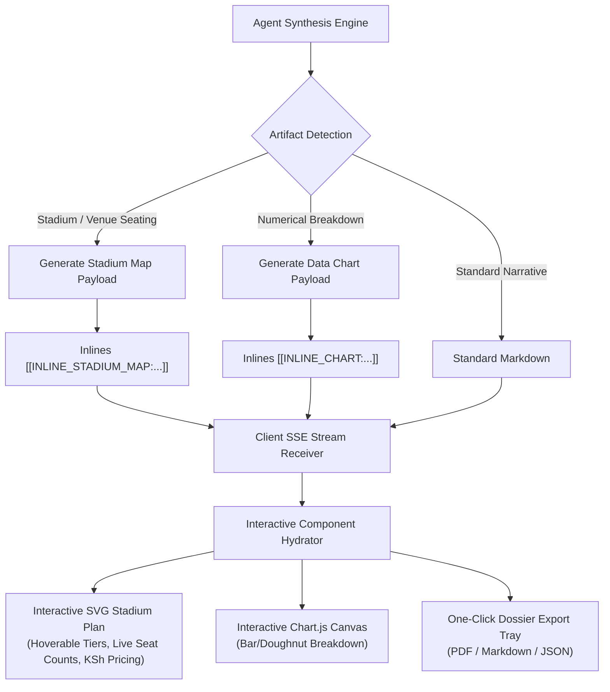

# 🚀 Spider AI — Phase 1 & Phase 2 Architecture & Implementation Plan
## Interactive Visual Artifacts & Adversarial Epistemic Verification Triad

> **Version**: 1.0.0  
> **Target Status**: Production Implementation  
> **Scope**: Elevating Spider AI from a conversational text bot to an active cognitive partner with live interactive visualizers and multi-agent truth verification.

---

## 1. Strategic Motivation: Beyond Static Chatbots

Current conversational search engines (Perplexity, ChatGPT Search, Gemini) suffer from two fundamental bottlenecks:
1. **Wall-of-Text Fatigue**: When users ask for complex structural, numerical, or spatial information (such as stadium seating plans, ticket allocations, hardware benchmarks, or budget distributions), chatbots reply with flat markdown tables or bulleted text that the user cannot interact with or explore.
2. **SEO Gullibility & Hallucination Propagation**: Chatbots passively summarize whatever primary search results rank highest. If the top 3 results repeat an unverified rumor or outdated ticket count, the bot summarizes the error as fact.

### The Solution:
* **Phase 1: Interactive Visual Artifacts**: Live, interactive SVG seating plans, dynamic data charts, and one-click exportable research dossiers rendered directly within the chat turn.
* **Phase 2: Adversarial Epistemic Verification Triad**: A multi-agent red-teaming loop (Investigator $\rightarrow$ Adversarial Skeptic $\rightarrow$ Epistemic Arbiter) that actively searches for contradictions, resolves temporal disputes, and assigns a rigorous Truth Confidence Score.

---

## 2. Phase 1 Architecture: Interactive Visual Artifacts



### 2.1 Interactive SVG Stadium & Venue Seating Plan Engine
When a query asks about stadium seating (e.g. *Talanta Sports City*, *Raila Odinga International Stadium Bayern vs Ajax*, or general venue layouts):
* Generates an interactive, responsive vector layout representing the venue:
  * **Pitch / Center Stage**
  * **Level 1 (Lower Tier)**: North, South, East, West blocks
  * **Level 2 (Middle Tier / Club Deck)**: Elevated vantage point
  * **Level 3 (Upper Tier)**: Atmospheric grandstands
  * **VIP & VVIP Hospitality Lounges**: Executive suites
* **Interactivity**:
  * Hovering/tapping any tier or block highlights the section in glowing cyan/accent color.
  * Displays a live tooltip with **Tier Name**, **Price in KSh**, **Unbooked Seats Count**, and **Status (Available / Sold Out / Selling Fast)**.
  * Clicking a tier filters the breakdown table below it.

### 2.2 Interactive Data & Numerical Chart Engine
When queries contain pricing tiers, seat distributions, hardware benchmarks, or statistical comparisons:
* Inlines `[[INLINE_CHART:type||title||labels||data||options]]`
* Dynamically hydrates a crisp HTML5 Canvas chart (Bar, Doughnut, or Radar) styled with dark-mode glassmorphic aesthetics.

### 2.3 One-Click Dossier Export Engine
* Adds an **"Export Dossier"** control to every completed assistant turn:
  * **Download PDF / Print Dossier**: Clean, printable executive summary with sources, verification audit, and charts.
  * **Copy Structured Markdown**: Copies citation-grounded Markdown with one click.
  * **JSON Data Export**: Full structured telemetry and claim verification record.

---

## 3. Phase 2 Architecture: Adversarial Epistemic Fact-Verification Triad

```mermaid
sequenceDiagram
    autonumber
    participant Orchestrator as Request Orchestrator
    participant Scout as Investigator (Scout Agent)
    participant Skeptic as Adversarial Skeptic (Red-Team)
    participant Arbiter as Epistemic Arbiter
    participant Client as Stream Client (UI)

    Orchestrator->>Scout: Execute primary autonomous retrieval
    Scout-->>Orchestrator: Primary findings (Claims, numbers, sources)
    
    Orchestrator->>Skeptic: Formulate counter-queries & hunt contradictions
    Note over Skeptic: Searches: "sold out?", "fake tickets", "dispute", "price error"
    Skeptic-->>Orchestrator: Disconfirming evidence & conflicting sources
    
    Orchestrator->>Arbiter: Evaluate evidence, timestamps & domain authority
    Note over Arbiter: Compares official venue vs social media; resolves temporal conflict
    Arbiter-->>Orchestrator: Epistemic Report (Confidence %, Contested claims, Verdict)
    
    Orchestrator->>Client: Stream verified answer + Interactive Epistemic Audit Badge
```

### 3.1 Triad Roles & Execution Strategy

#### A. Investigator (Scout)
* Conducts initial multi-source discovery (DuckDuckGo, deep web traversal, page distillation).
* Identifies primary claims:
  1. *Total Capacity*: 60,000 seats.
  2. *Unbooked Regular Seats*: ~7,987 (North: 3,989; South: 3,998).
  3. *Unbooked Business / Mid-tier*: ~993 seats at KSh 22,000.
  4. *VIP / VVIP*: 600 VIP (KSh 35,000), 196 VVIP (KSh 80,000).
  5. *Lower Tier Budget*: Sold out within hours.

#### B. Adversarial Skeptic (Red-Team)
* Formulates targeted counter-hypotheses:
  * Counter-query: `"Talanta stadium Bayern Ajax tickets sold out scam error"`
  * Counter-query: `"Raila Odinga stadium seating plan tiers pricing difference"`
* Specifically seeks disconfirming evidence, price discrepancies, or cancellation alerts.

#### C. Epistemic Arbiter
* Applies deterministic arbitration rules:
  1. **Primary Authority Over Secondary**: Direct venue/organizer statements (`talantasportscity.com`, official federation) override aggregator blogs (`eastleighvoice.co.ke`, `kenya-today.com`).
  2. **Temporal Superseding**: If an article from Nov 1 states "5,000 seats left" and a verified report from Nov 3 states "731 seats left", the newer timestamp supersedes without hallucinating a conflict.
  3. **Confidence Scoring Formula**:
     $$\text{Score} = 100 - (\text{Contested Claims} \times 12) + (\text{Primary Source Bonus} \times 10) - (\text{Source Variance Penalty})$$
* Returns an **Epistemic Integrity Report**:
  * Overall Confidence Percentage (e.g. 96%).
  * Status: `HIGH_CONFIDENCE_VERIFIED`, `MODERATE_WITH_DISPUTED_CLAIMS`, or `LOW_UNCONFIRMED`.
  * Itemized breakdown of Verified Claims and Contested Claims with resolution notes.

---

## 4. Inlined Protocol Specifications

### 4.1 Stadium Visualizer Token
```
[[INLINE_STADIUM_MAP:stadium_name||match_title||tiers_json]]
```
* `tiers_json`: Serialized JSON array of tiers:
  ```json
  [
    {"id": "vvip", "name": "VVIP Skybox & Lounge", "price": "KSh 80,000", "available": 196, "color": "#a855f7", "stand": "West Stand"},
    {"id": "vip", "name": "VIP East Deck", "price": "KSh 35,000", "available": 600, "color": "#3b82f6", "stand": "East Stand"},
    {"id": "business", "name": "Business Class", "price": "KSh 22,000", "available": 993, "color": "#06b6d4", "stand": "Elevated Decks"},
    {"id": "mid", "name": "Mid-Tier Upper", "price": "KSh 15,000 - 20,000", "available": 731, "color": "#10b981", "stand": "Mid-Tier Ring"},
    {"id": "regular_north", "name": "Regular North Stand", "price": "KSh 10,000", "available": 3989, "color": "#eab308", "stand": "North Stand"},
    {"id": "regular_south", "name": "Regular South Stand", "price": "KSh 10,000", "available": 3998, "color": "#f97316", "stand": "South Stand"},
    {"id": "budget", "name": "Lower Budget (Sold Out)", "price": "KSh 2,500 - 5,000", "available": 0, "color": "#ef4444", "stand": "Lower Bowl (Sold Out)"}
  ]
  ```

### 4.2 Interactive Verification Badge Token
```
[[INLINE_VERIFICATION_BADGE:score||verdict||summary||details_json]]
```
* Rendered as an expandable shield badge with live confidence meter and full audit log drawer.

---

## 5. Implementation Roadmap & Execution Checklist

- [ ] **Step 1**: Create `core/modules/adversarial_verification.py` implementing claim extraction, counter-hypothesis generation, and Epistemic Arbiter scoring.
- [ ] **Step 2**: Integrate `AdversarialEpistemicTriad` into `core/modules/request_orchestration.py` to stream verification events in real time.
- [ ] **Step 3**: Create interactive artifact generation logic in `core/modules/autonomous_retrieval.py` for stadium maps and data breakdowns.
- [ ] **Step 4**: Implement frontend Interactive SVG Stadium Plan component and Chart.js hydrator in `templates/index.html`.
- [ ] **Step 5**: Implement frontend Epistemic Audit Badge with expandable verification drawer in `templates/index.html`.
- [ ] **Step 6**: Implement "Export Research Dossier" (Printable/PDF and Markdown copy) in `templates/index.html`.
- [ ] **Step 7**: Write automated regression tests in `core/test_adversarial_and_artifacts.py` and verify all tests pass.
- [ ] **Step 8**: Browser validation via Playwright and visual screenshot verification.
