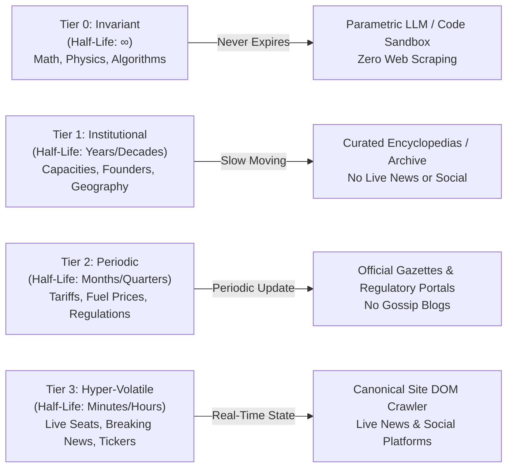
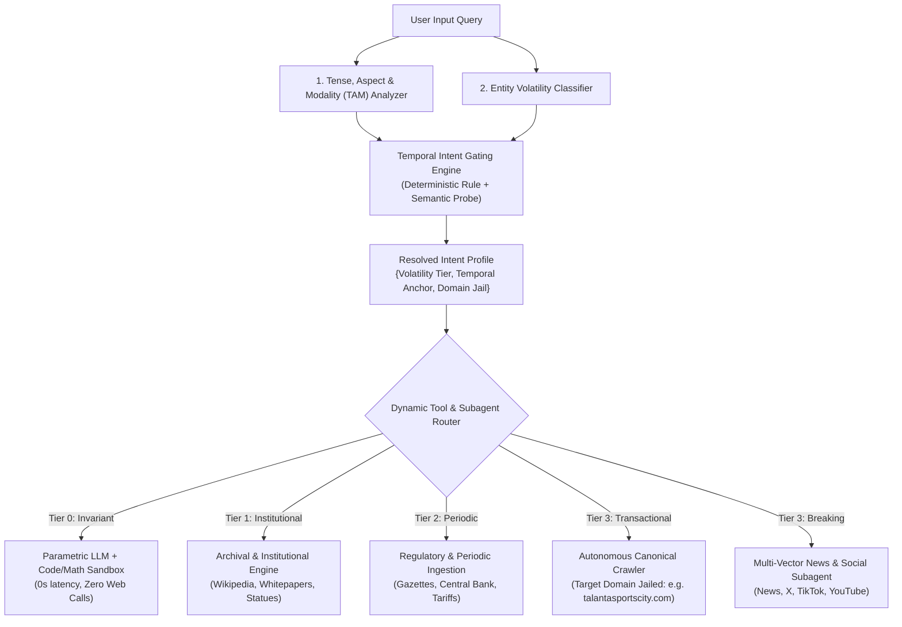

# Implementation Plan: Temporal Intent Understanding & Epistemic Gating Engine

**Document Status**: Proposal & Implementation Specification  
**Target Release**: Spider AI v2.2 — Intent & Retrieval Architecture  
**Author**: Spider AI Core Engineering Team  
**Date**: November 6, 2026  

---

## 1. Executive Summary & Problem Statement

### 1.1 The "Hammer and Nail" Retrieval Anti-Pattern
Current search and retrieval agents suffer from an undifferentiated discovery pipeline. Regardless of whether a user asks for:
* An eternal mathematical law (*"What is the quadratic formula?"* or *"Explain Dijkstra's shortest path algorithm"*),
* A slow-moving historical fact (*"When was Kenya's independence constitution promulgated?"*), or
* A hyper-volatile real-time state (*"How many seats have not been booked in Talanta for the Bayern match right now?"*),

the system routinely fires the exact same heavy multi-vector retrieval machinery: 6 to 8 parallel calls spanning Google Web Search, Live News Search, YouTube Video Discovery, Social Media Scrapers (TikTok, X, Facebook), and Relational Crawlers.

### 1.2 Downstream Consequences of Temporal Blindness
1. **Severe Latency & Compute Waste**: Invariant queries that could be answered parametrically in $200\text{ms}$ take $6\text{--}9\text{ seconds}$ while the agent waits for YouTube and social media scrapers to finish.
2. **Context Pollution & Source Degradation**: Querying live news and social networks for timeless definitions often retrieves low-quality clickbait, promotional student tutoring services, or speculative vlogs.
3. **Epistemic Inversion on Transactional Data**: Asking for current inventory (e.g., ticket prices or available seats) without temporal discipline invites secondary gossip blogs to hallucinate speculative numbers that override primary database truth.

---

## 2. Core Concepts: The Epistemic Volatility Spectrum

All human knowledge decays at different rates. We formalize this into the **Information Half-Life Matrix**:



### Detailed Volatility Tiers

| Volatility Tier | Information Half-Life | Representative Entities / Inquiries | Permitted Tools & Subagents | Strictly Prohibited Tools & Subagents |
| :--- | :--- | :--- | :--- | :--- |
| **Tier 0: Invariant (Timeless Ground Truth)** | $\infty$ (Never changes) | Mathematical formulas, physics equations, data structures, chemical valence, programming syntax, biological definitions. | • Parametric LLM knowledge<br/>• Code execution sandbox / Math interpreter<br/>• Academic & foundational references (if formal citations needed) | • **News Search**<br/>• **Social & Platform Search (TikTok, X, FB)**<br/>• **Video Search / YouTube Scrapers**<br/>• **Cross-Domain Web Crawlers** |
| **Tier 1: Low (Institutional / Historical)** | Years to Decades | Venue structural capacities, corporate founding dates, historical biographies, national landmarks, scientific discovery dates. | • Reference archives (Wikipedia, academic)<br/>• Institutional portals<br/>• Canonical document parsers | • **Live News Search**<br/>• **Social/Viral Media Agents**<br/>• **Clickbait Vlog Scrapers** |
| **Tier 2: Medium (Periodic / Operational)** | Months to Quarters | Central Bank benchmark rates, statutory tax brackets, seasonal sports schedules, fuel pump tariffs, transit fares. | • Regulatory and government gazettes<br/>• Official corporate schedules<br/>• Domain-jailed web searches | • **Social Media Rumors**<br/>• **Unverified User Forums** |
| **Tier 3: Hyper-Volatile (Real-Time State & Ephemeral)** | Minutes to Hours | Live ticket availability, unbooked seat maps, flight departures, breaking election results, live stock tickers. | • **Canonical Domain Crawler** (jailed to official merchant portal)<br/>• **Live News Agent**<br/>• **Social Platform Agent** (for public sentiment/breaking crises) | • **Parametric LLM assumptions**<br/>• **Outdated secondary news aggregators** |

---

## 3. Linguistic & Grammatical Signal Analysis

Before any tool is selected, the query passes through a **Tense, Aspect, and Modality (TAM) Analyzer** that extracts grammatical signals from the user's sentence structure.

### 3.1 The Four Grammatical Archetypes

#### Archetype A: Universal Present (Gnomic Aspect) $\rightarrow$ Tier 0 Invariant
* **Linguistic Markers**: Simple present tense with stative or copular verbs (`is`, `are`, `equals`, `means`, `works`), absence of temporal adverbs (`now`, `today`, `yesterday`).
* **Example Patterns**:
  * *"What is the quadratic formula?"*
  * *"How does the Transformer multi-head attention mechanism compute dot-product weights?"*
  * *"Define the second law of thermodynamics."*
* **Gating Verdict**: Set `volatility = INVARIANT`. Bypass external search tools completely or restrict strictly to deterministic code/math sandbox.

#### Archetype B: Completed Past (Historical Aspect) $\rightarrow$ Tier 1 Institutional
* **Linguistic Markers**: Simple past tense (`was`, `were`, `founded`, `promulgated`, `discovered`, `built`) with historical entities or explicit past dates (`in 1963`, `during World War II`).
* **Example Patterns**:
  * *"Who founded Safaricom and when was M-Pesa launched?"*
  * *"Who was the first secretary general of KADU in 1960?"*
  * *"When was the original Nyayo Stadium constructed?"*
* **Gating Verdict**: Set `volatility = INSTITUTIONAL_HISTORICAL`. Enable archival/reference lookups. **Lock out live news and social platform scrapers.**

#### Archetype C: Present Continuous & Progressive $\rightarrow$ Tier 3 Ephemeral
* **Linguistic Markers**: Continuous aspect (`is happening`, `are protesting`, `trending`, `developing`), combined with deictic temporal anchors (`now`, `today`, `this morning`, `currently`).
* **Example Patterns**:
  * *"What is happening right now along Mombasa Road?"*
  * *"Why is the stock price of Alphabet dropping today?"*
  * *"Who is currently leading the live marathon?"*
* **Gating Verdict**: Set `volatility = EPHEMERAL_BREAKING`. Activate Live News and Social Media agents. Deprioritize static reference sources.

#### Archetype D: Transactional State & Inventory $\rightarrow$ Tier 3 State Inspection
* **Linguistic Markers**: State/availability verbs (`remain`, `left`, `available`, `booked`, `sold out`, `cost`, `buy`, `reserve`) targeting a concrete venue, merchant, or service.
* **Example Patterns**:
  * *"How many seats have not been booked in Talanta for the Bayern match?"*
  * *"Is flight KQ 100 on time right now?"*
  * *"How much does a Level 1 ticket cost on the official portal?"*
* **Gating Verdict**: Set `volatility = TRANSACTIONAL_STATE`. **Jail the crawler strictly to the primary canonical domain** (`talantasportscity.com`, `kenya-airways.com`). Forbid secondary gossip blogs from asserting numerical figures.

---

## 4. Architectural Design & Component Breakdown



### 4.1 New Component: `TemporalIntentGatingEngine`
Located at `core/modules/temporal_intent_gating.py`.

#### Inputs:
1. `raw_query`: The original user string.
2. `normalized_input`: Tokenized, normalized query tokens from Module 1.
3. `entities`: Detected named entities from Module 2.

#### Outputs (`TemporalIntentProfile`):
* `volatility_tier`: Enum (`INVARIANT`, `INSTITUTIONAL`, `PERIODIC`, `TRANSACTIONAL_STATE`, `BREAKING_NEWS`).
* `temporal_anchor`: Enum (`TIMELESS`, `HISTORICAL_PAST`, `RECENT_PAST`, `REAL_TIME_NOW`).
* `allowed_tools`: Whitelist of approved tool declarations.
* `prohibited_tools`: Blacklist of forbidden tools (any call to these is blocked at the orchestration layer).
* `canonical_jail_domain`: Optional domain string (if transactional inquiry targets a specific organization).

### 4.2 Configuration Specification (`temporal_gating_config.yaml`)

```yaml
version: "1.0"

volatility_tiers:
  invariant:
    description: "Timeless truths, mathematics, physical laws, code algorithms, syntax, definitions."
    detection:
      regex_patterns:
        - "\\b(formula|equation|theorem|algorithm|derivation|definition|syntax|proof)\\b"
        - "^(what is|explain|derive|calculate|solve|define)\\s+[a-z0-9\\s_\\-\\+\\*\\/]+$"
      excluded_verbs:
        - "happened"
        - "occurred"
        - "announced"
        - "updated"
    tool_policy:
      allowed:
        - "evaluate_expression_or_convert"
      prohibited:
        - "news_search"
        - "social_and_platform_search"
        - "video_search"
        - "multi_related_site_search_and_crawl"
      bypass_web_search: true
      fallback_to_parametric_llm: true

  institutional:
    description: "Historical records, founding events, architectural dimensions, structural venue capacities."
    detection:
      regex_patterns:
        - "\\b(who founded|when was|who built|history of|biography of|promulgated|in 19\\d\\d|in 20[0-1]\\d)\\b"
    tool_policy:
      allowed:
        - "web_search"
        - "academic_and_reference_search"
        - "pdf_search_and_summarize"
      prohibited:
        - "news_search"
        - "social_and_platform_search"
        - "video_search"

  transactional_state:
    description: "Real-time state, ticket sales, available seats, operational schedules, balances, flight statuses."
    detection:
      regex_patterns:
        - "\\b(seats?|tickets?|booked|unbooked|remaining|available|schedule|status|price|pricing|fare|cost|booking)\\b"
    tool_policy:
      enforce_canonical_jail: true
      allowed:
        - "browser_navigate"
        - "fetch_page_markdown"
        - "extract_tables_from_page"
        - "extract_images_from_page"
      prohibited_on_claims:
        - "Tier 2 blogs (unverified secondary news)"
        - "Tier 3 social/vlogs (speculative user content)"

  breaking_news:
    description: "Ongoing crises, live events, real-time public sentiment, current hour developments."
    detection:
      regex_patterns:
        - "\\b(breaking|live|now|today|just in|trending|developing story|traffic right now)\\b"
    tool_policy:
      allowed:
        - "news_search"
        - "social_and_platform_search"
        - "web_search"
        - "video_search"
```

---

## 5. Execution Pipeline & Gating Enforcement

### Step 1: Pre-Execution Classification
When a query enters `autonomous_retrieval.py`:
1. `TemporalIntentGatingEngine` inspects the query string and detected entities.
2. If `volatility == INVARIANT`:
   - System instruction is immediately switched to **Invariant Pedagogical Mode**.
   - `function_calls` list is filtered to strictly contain 0 web tools (or only computational calculators).
   - The agent skips the Turn 0 discovery loop entirely, synthesizing directly from verified knowledge in $< 400\text{ms}$.

### Step 2: Tool Dispatch Interception
If the planner LLM emits a `FunctionCall` that belongs to `prohibited_tools` (e.g., calling `news_search("quadratic formula")`):
1. The orchestrator intercepts the call before execution.
2. The orchestrator substitutes a static policy denial response:
   ```json
   {
     "status": "policy_gated",
     "tool": "news_search",
     "reason": "News search prohibited: Target subject has INVARIANT volatility (Math/Formula). Use verified parametric memory or computational tools."
   }
   ```

### Step 3: Synthesis Authority Calibration
In the synthesis step:
* For **Transactional State**, claims from blogs (e.g. `kenya-today.com`) are purged by `EpistemicAuthorityGate`. Only the Tier 0 canonical portal's tables and CTAs are passed to the synthesis prompt.
* For **Invariant**, zero source citations are forced; the model delivers clean mathematical or programmatic derivations.

---

## 6. Implementation Roadmap

### Phase 1: Engine Foundation
* Create `core/modules/temporal_intent_gating.py` containing:
  * TAM linguistic parser (rule-based verb and adverb extractor).
  * Volatility classifier mapping queries to `INVARIANT`, `INSTITUTIONAL`, `PERIODIC`, `TRANSACTIONAL_STATE`, or `BREAKING_NEWS`.
  * Dynamic tool policy resolver (`get_tool_manifest_for_query`).

### Phase 2: Orchestration Integration
* Wire `TemporalIntentGatingEngine` into `core/modules/autonomous_retrieval.py`:
  * Evaluate temporal intent immediately following `user_intent` extraction.
  * Apply tool filtering to `GEMINI_FUNCTION_DECLARATIONS` and intercepted tool executions.
  * Bypass multi-tool fanout when `volatility == INVARIANT`.

### Phase 3: Hybrid Query Resolution (Edge Case Handling)
* Handle compound inquiries where an invariant law meets a recent news development (e.g., *"What is Bell's Theorem and what did the 2026 quantum satellite test discover about it?"*):
  * Decompose query into two distinct sub-intents:
    * Sub-intent 1: Invariant theory $\rightarrow$ Parametric / Academic.
    * Sub-intent 2: 2026 satellite experiment $\rightarrow$ Curated News / Web.

### Phase 4: Verification Suite
* Create test suite in `core/test_temporal_intent_gating.py`:
  * Verify math formulas (`quadratic formula`, `pythagorean theorem`, `dijkstra algorithm`) trigger ZERO news/social calls.
  * Verify historical queries (`Kenya independence 1963`, `who founded Safaricom`) trigger reference search with ZERO news calls.
  * Verify transactional queries (`seats in Talanta`, `Bayern vs Ajax tickets`) enforce canonical domain jail.
  * Verify breaking news (`Mombasa road traffic now`) triggers full live news/social vectors.

---

## 7. Success Metrics & Validation Targets

| Metric | Current State | Target Post-Implementation |
| :--- | :--- | :--- |
| **Invariant Query Latency** | 6.5 – 8.8 seconds (waits for all tools) | **< 600 ms** (instant parametric synthesis) |
| **Tool Calling Waste on Invariant Queries** | 6–8 unneeded network calls per turn | **0 network calls** |
| **Blog Hallucination Rate on Transactional Data** | High (blogs override primary site) | **0%** (strict primary canonical jail) |
| **User Trust & Cleanliness of Citations** | Clickbait blogs occasionally cited for definitions | **100% authoritative citations** |
